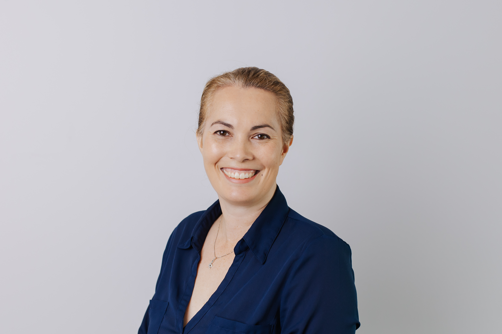
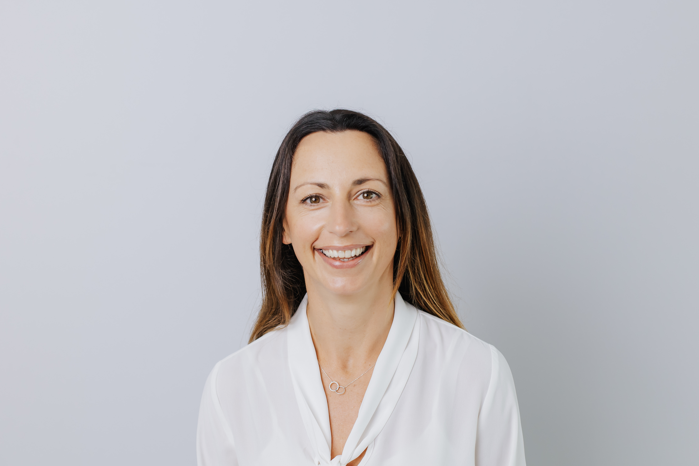
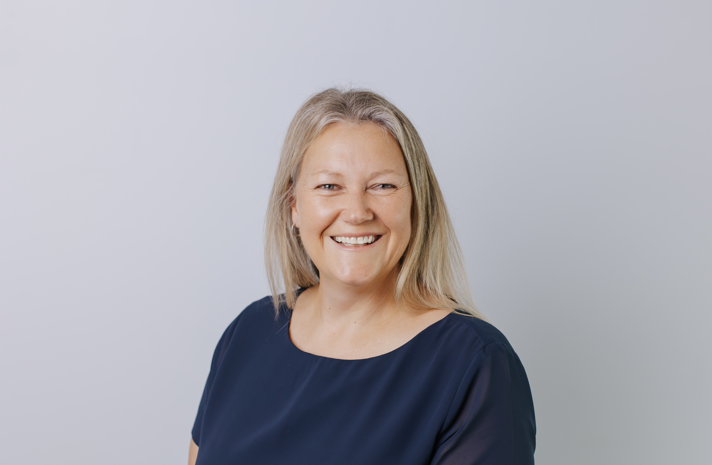
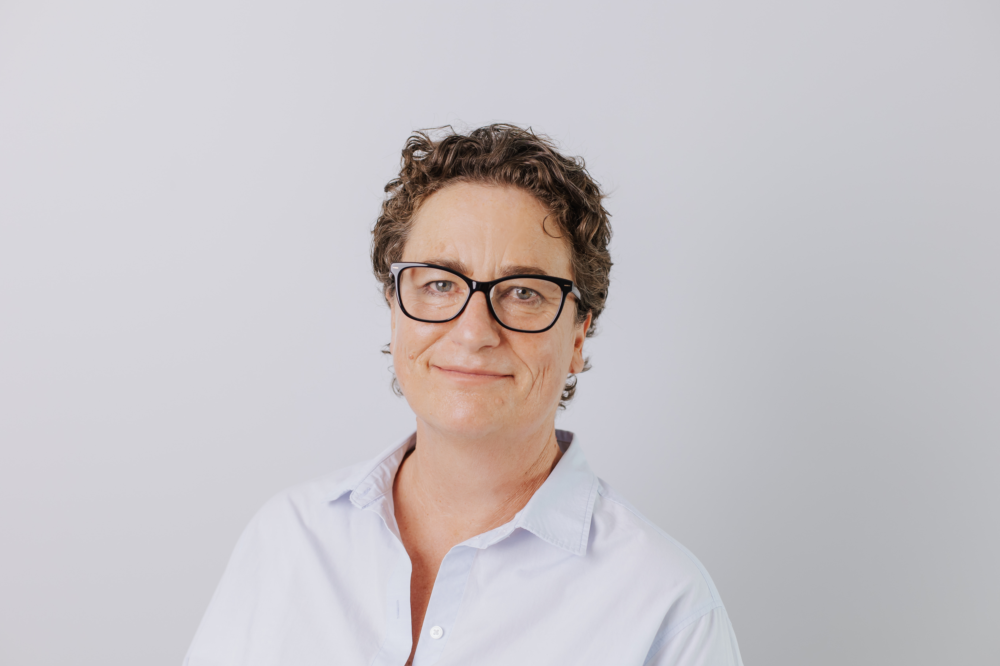

Northland Chartered Accountants is a Kerikeri and Whangarei based firm catering to businesses in the Northland area. It also powers the business advisory service Lighthouse Advisory.

With our wide range of accounting experience and knowledge we're ready and able to support you with all your business and accounting needs.

Our experience includes (but is not limited to) accounting and advisory work for the following industries:

- Accommodation and hospitality
- Agriculture
- Construction and trades
- Manufacturing
- Media and communications
- Professional services
- Real estate
- Retail
- Transportation

With our online software solutions it’s now possible to keep an even closer eye on your finances. As changes happen and your business evolves we can provide timely advice and support.

We are there for you on this journey.

---

## Our Team

### Mere Teinaki CA – Director

Mere is a dedicated Chartered Accountant with expertise in Xero, tax advisory, and simplifying complex accounting processes for clients. Her passion lies in making clients’ lives easier by streamlining their accounting and tax systems and explaining financial concepts in plain English.

A career highlight for Mere is her service on the Xero Partner Advisory Council, where she contributed to shaping Xero’s approach to supporting small businesses and accounting practices.

Outside of work, Mere is a talented musician who plays in the Northland Sinfonia and participates in local theatre productions, including *The Phantom of the Opera*, *Chicago* and *West Side Story*. She values working in the winterless north, helping the community with their accounting needs, and being part of a supportive and friendly team.



---

### Melissa Alexander – Client Manager

Melissa specialises in supporting new business start-ups and providing expert Xero assistance. She takes pride in helping clients understand their accounts, achieve their goals, and grow in confidence as business owners. Anticipating client needs and offering forward-thinking solutions are key aspects of her approach.

A proud milestone in her career is completing her degree.

Outside of work, Melissa enjoys growing organic food on her lifestyle block, spending quality time with her family, and beach camping adventures. She values being part of a close-knit, supportive team that places clients and their needs at the heart of everything they do.

---

### Trish Madison – Client Manager

Bio coming soon.......

---

### Nicole Kingi – Client Manager

Bio coming soon.......

---

### New team member – Coming soon

We’re currently recruiting for our next team member in our Kerikeri office – someone with solid public practice experience who enjoys working with people just as much as numbers. 

If this is you, please send your resume to office@northlandca.co.nz.

---

### Shelley Tylden – Client Manager

Shelley brings a wealth of accounting expertise to the team, with a particular knack for connecting with clients from all walks of life. Growing up on a sheep and beef farm and now living on a dairy farm, Shelley has a strong affinity for the farming community. Her favourite part of the job is helping clients meet their tax obligations with ease and working collaboratively to achieve great results.

Outside of work, Shelley enjoys life on the farm with her three children and loves the thrill of fishing in the Bay of Islands, always on the hunt for the “catch of the day.” She values the close-knit team environment and the shared commitment to putting clients first.

---

### Jan Lyall – Practice Manager

Jan brings a unique blend of warmth and efficiency to the team, excelling at everything from admin to crafting the perfect coffee. With a natural talent for connecting with people and gently ensuring payments are on track, Jan’s strength lies in building relationships.

Her favourite part of the job is meeting new people and contributing to the team’s happy, harmonious vibe. Jan loves being part of a diverse and collaborative group, where everyone’s differences come together to create something special.

---

